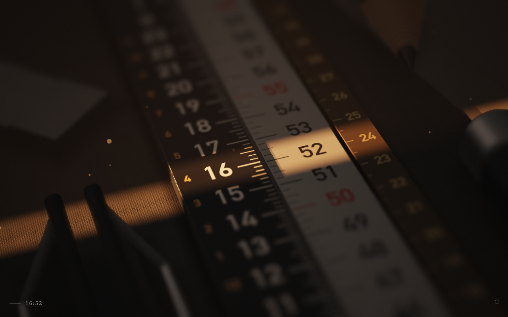

# clock-work

Clocks for the Chrome new tab page. Each folder is a separate Manifest V3 extension with no permissions and no network requests.

| Clock | What it is |
|---|---|
| [kinetic/](kinetic/) | Kinetic Clock: the time assembled from small sprung tiles that land exactly on the second. |
| [komorebi/](komorebi/) | Komorebi Clock: soft tree shadows on a wall, cast by the sun of the hour; one branch hidden among them tells the time. |
| [sunlit/](sunlit/) | Sunlit Scale: three scales on a desk under a macro lens; they slide so the current time stands in a line of sunlight, or at night a desk lamp's. |

Built packages (`dist/`), promo videos (`media/`) and old design iterations (`attic/`) stay local and are git-ignored.

## Site: Clock Studies

The clocks are also a small site, 時計のエチュード / Clock Studies, at https://clock.sayuno.me, served from Cloudflare (Workers static assets on a custom domain, see `wrangler.jsonc`). Wrangler keeps this repo's Cloudflare login in `.wrangler-home/` (git-ignored, `npm run login`), apart from any other login on the machine.

- `npm run build` builds `dist/site` from `site/etudes.json`: the index of studies, and one live page per study (the extension's own page, with a faint link back to the index).
- A push to `main` deploys it: Cloudflare Workers Builds runs `npm run build` and `npx wrangler deploy`. `npm run deploy` does the same by hand.

To add the week's étude:

1. Make the clock as `<slug>/extension/`, a Manifest V3 new tab extension whose page is `newtab.html`.
2. Put a 1280×800 image of it at `site/img/<slug>.jpg`.
3. Add an entry at the top of `site/etudes.json`: its number, slug, date, a title and one sentence in Japanese and English, and `store` once it is on the Chrome Web Store. In a Japanese title, `|` marks where the line may break.
4. Push to `main`.

## Tools

`tools/` runs a clock in Chrome for Testing, headless but on the real GPU (WebGL through Metal), to check it and to make its pictures. Run `npm install --prefix tools` once, and `npx --prefix tools playwright-core install chromium` if there is no Chrome for Testing yet. Each tool describes its options at the top of its file.

- `node tools/shoot.mjs komorebi/extension/newtab.html "t=10:08&seed=0"`: screenshots, one for each hash.
- `node tools/record.mjs komorebi/extension/newtab.html --hash "seed=0" --secs 10 --mp4 out.mp4`: a video in which every frame is exact, since time inside the page is virtual.
- `node tools/crossfade.mjs out.mp4 a.mp4 b.mp4`: clips joined with crossfades.
- `node tools/ext-check.mjs komorebi/extension`: the clock as Chrome runs the extension, with its errors, permissions, name and description.
- `node komorebi/store/media.mjs shots|videos`: Komorebi Clock's store images and promo videos, made again.
- `node sunlit/store/media.mjs shots|videos`: Sunlit Scale's store images and promo videos, made again.
- `node --test komorebi/test/sky.test.mjs`: Komorebi Clock's sun, moon and almanac against known dates.

---

Chrome の新しいタブ用の時計を集めたリポジトリです。
