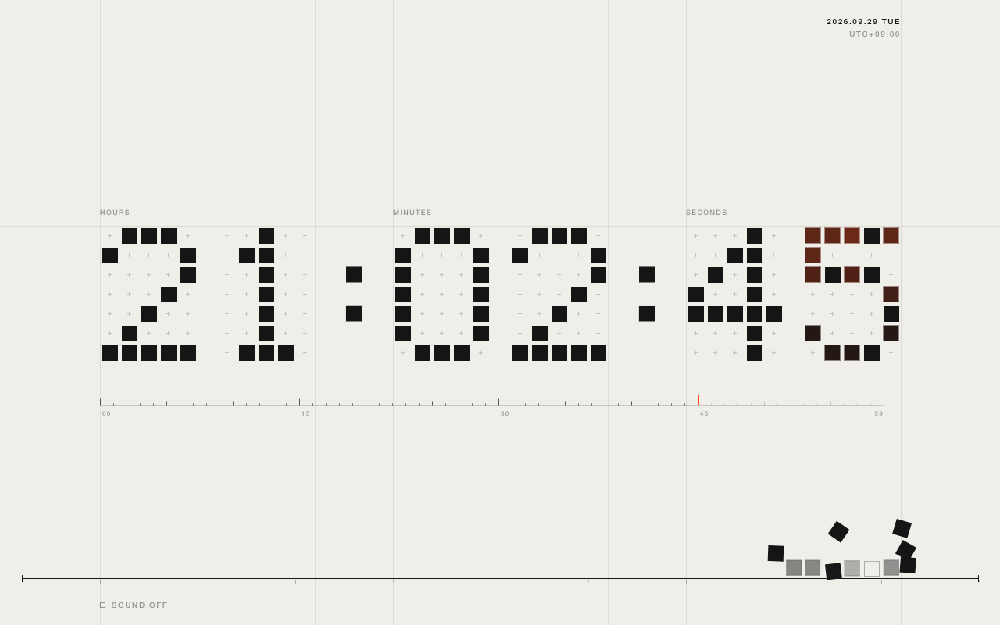

# clock-work

Clocks for the Chrome new tab page. Each folder is a separate Manifest V3 extension with no permissions and no network requests.

| Clock | What it is |
|---|---|
| [kinetic/](kinetic/) | Kinetic Clock: the time assembled from small sprung tiles that land exactly on the second. |
| [komorebi/](komorebi/) | Komorebi Clock: soft tree shadows on a wall, cast by the sun of the hour; one branch hidden among them tells the time. |

Built packages (`dist/`), promo videos (`media/`) and old design iterations (`attic/`) stay local and are git-ignored.

## Site: On-screen Clock Études

The clocks are also a small site, オンスクリーン時計のエチュード / On-screen Clock Études, served from Cloudflare (Workers static assets, see `wrangler.jsonc`).

- `npm run build` builds `dist/site` from `site/etudes.json`: the index of études, and one live page per étude (the extension's own page, with a faint link back to the index).
- `npm run deploy` builds and deploys it with Wrangler.

To add the week's étude:

1. Make the clock as `<slug>/extension/`, a Manifest V3 new tab extension whose page is `newtab.html`.
2. Put a 1280×800 image of it at `site/img/<slug>.jpg`.
3. Add an entry at the top of `site/etudes.json`: its number, slug, date, a title and one sentence in Japanese and English, and `store` once it is on the Chrome Web Store. In a Japanese title, `|` marks where the line may break.
4. `npm run deploy`.

---

Chrome の新しいタブ用の時計を集めたリポジトリです。
