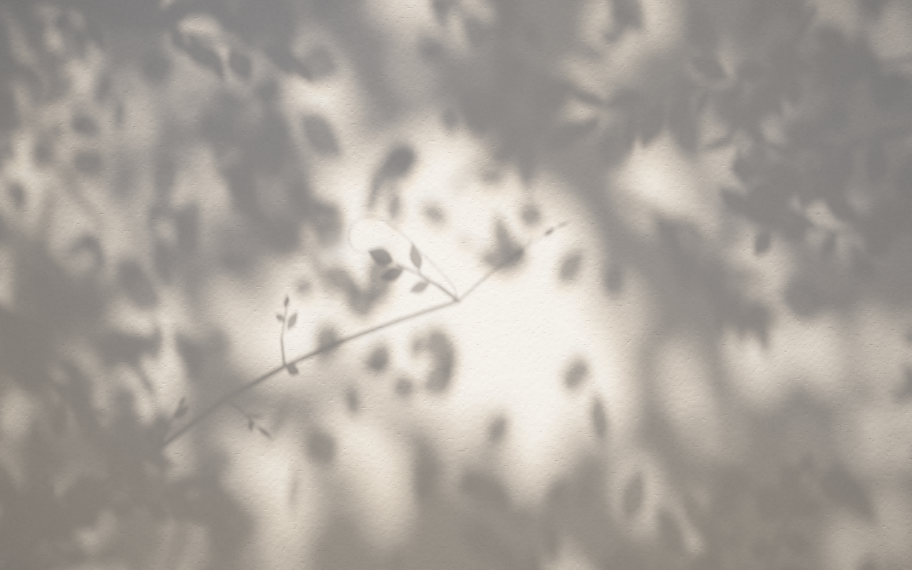

# Komorebi Clock New Tab

A Chrome extension that replaces the new tab page with sunlight falling through leaves onto a plaster wall. It is a clock without numerals: the time is told by the shadow of a branch and its twigs.

Everything on the wall is a shadow of something in front of it, cast by a sun that moves with the local hour. A far canopy (5 to 9 m from the wall) is an almost closed roof of leaves; the light through its gaps lands as soft, round pinhole images of the sun. A nearer layer of leaves (2 to 3 m) casts soft patches without clear outlines, and about twenty branches, more of them toward the corners, hang between 0.6 and 2 m from the wall, so their shadows are soft. A branch reaches in from beyond the edge, close to the wall, and ends in the clearing. The branch itself is the hour hand: from its tip outward it points at the hour. Two twigs grow from the tip: a long slender one with narrow willow leaves is the minute hand, and the thinnest, with a few small leaves, sweeps the seconds. The branch's side twigs look much like them, so the time hides among them until you look for it. The farther something is from the wall, the softer its shadow, because the sun is a disc rather than a point; a slight lens defocus softens everything a little more, and the brightest edges of the dappled light split faintly into colour. Each minute the shadow of a small cloud passes over. The light follows the local hour: pink-orange at dawn, warm white in the morning, bright and neutral at noon, golden with long ellipses in the late afternoon, deep orange at dusk, and cool blue moonlight at night.



- Manifest V3, no permissions, no network requests
- WebGL 1 and vanilla JavaScript, no build step, no text on screen
- Shadows are computed from 3D leaves and twigs: each layer is projected along the sun onto the wall, then averaged over the sun's disc
- Moving the pointer nudges the wind and the sun a little; it works without a mouse
- Each new tab sets the trees out afresh: the branches, the leaves and the gaps in the canopy fall differently every time, while the clock stays in the middle
- Respects `prefers-reduced-motion` (slower wind, no gusts, a shorter and fainter cloud)
- Rendering is capped at about 30 fps when idle, with device pixel ratio capped at 1.5

## Debug

Click the faint ring in the lower-right corner (its accessible name is "playground"), press Shift+D, or add `#debug` to the page URL to show a sequence bar: a slider over the day's light (0 to 24 h), play and pause at x1 to x3600, a button that sends the minute's cloud across now, a button back to the real time, and a shuffle button that sets the trees out afresh. The bar shows the layout's seed; `#seed=N` brings that layout back (`#seed=0` is the one in the screenshots). `#t=HH:MM` fixes the time without the bar.

## Install from source

1. Open `chrome://extensions` and turn on Developer mode.
2. Click "Load unpacked" and choose the `extension/` folder.
3. Open a new tab.

To preview a fixed time of day, open the page with a hash such as `newtab.html#t=17:42`.

## Package for the Chrome Web Store

```sh
cd extension && zip -rqX ../komorebi-clock-newtab.zip manifest.json newtab.html newtab.js icons
```

Store graphics are in [`store/`](store/).

---

新しいタブを、漆喰の壁に落ちる木漏れ日で現在時刻を描く時計に置き換える Chrome 拡張機能です。権限・外部通信なし。
