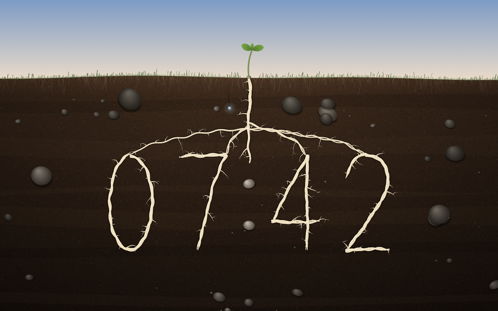

# Roots Clock New Tab (ねっこの時計)

A Chrome extension that replaces the new tab page with a cut through the ground under a small seedling. Down in the dark soil, its roots write the time.

Above is a strip of sky and grass in the light of the hour, and a seedling with two seed leaves and a first true leaf, swaying a little. Below, the earth is cut away like a page in a picture book: crumbly topsoil matted with fine grass roots, darker earth further down, soft strata, grains and stones. From the seedling one taproot goes down, and four roots run off it, sweeping out and down; each one grows into the figure of a digit, a bundle of a few twisted strands with fine rootlets that turn downward as they reach. When a figure changes, its old roots darken and go back into the soil while new ones grow out from the taproot and along the new figure, from its highest point both ways (about seven seconds). The colon is two pale stones in the middle. The seconds are a drop of rain: it leaves the surface at the top of each minute, seeps down between the grains, leaving a damp trail that dries behind it, and soaks into the upper stone as the minute turns. The sky follows the time of day, with stars at night.



- Manifest V3, no permissions, no network requests
- Canvas 2D and vanilla JavaScript, no build step; no text on the page, the figures are the roots
- Each new tab lays the soil out afresh and grows the roots anew; they grow in one after another when the tab opens
- Respects `prefers-reduced-motion` (the roots stand grown at once, the grass and the seedling are still)
- Drawn at the screen's full resolution (device pixel ratio up to 2) and about 30 fps; the soil and the roots are drawn again only while something grows or withers

## Debug

`#t=HH:MM` or `#t=HH:MM:SS` fixes the time, and `#seed=N` brings a soil and its roots back (the screenshots use seeds 3, 7, 2 and 5).

## Install from source

1. Open `chrome://extensions` and turn on Developer mode.
2. Click "Load unpacked" and choose the `extension/` folder.
3. Open a new tab.

## Package for the Chrome Web Store

```sh
mkdir -p ../dist/nekko && cd extension && zip -rqX ../../dist/nekko/roots-clock-newtab.zip manifest.json newtab.html newtab.js icons _locales
```

Store screenshots are in [`store/`](store/).

---

新しいタブを、小さな双葉の下の土の断面に置き換える Chrome 拡張機能です。暗い土のなかを根がのびて、いまの時刻を書きます。数字が変わるとき、古い根は土に還り、新しい根が主根から新しい数字へのびていきます。秒は、分のはじめに地表を離れて土にしみこんでいく、ひとしずくの雨です。権限・外部通信なし。
