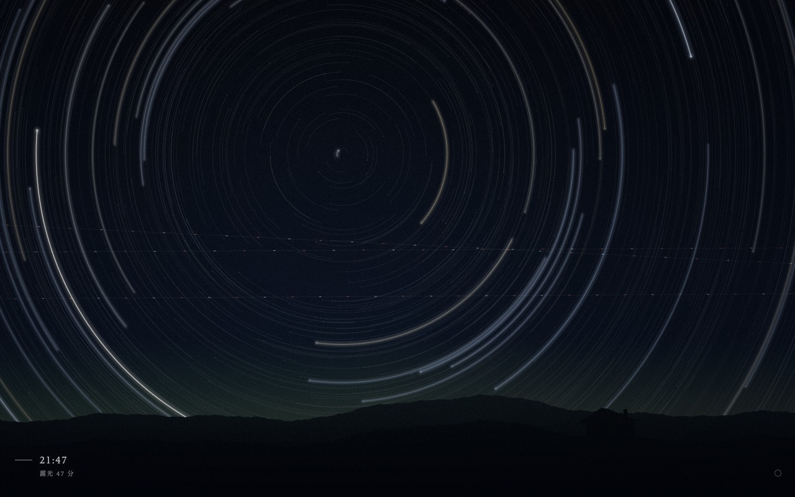

# Star Trail Clock New Tab

A Chrome extension that replaces the new tab page with a long exposure of the night sky. A new exposure begins on every hour; the stars trace arcs around the celestial pole, and the length of the arcs tells the minutes since the hour.

The sky is the real one overhead now. About 300 of the brightest stars (Hipparcos, by way of d3-celestial) sit at their true places for the local sidereal time, worked out from the browser's time zone (no location permission); some 2,000 fainter stars are added for density. Facing the north pole in the northern hemisphere and the south pole in the southern, the sky is drawn through a stereographic lens, so the star paths stay circles. Each star's colour comes from its B−V index, from blue-white to orange. The arcs grow six times faster than the sky turns (90° an hour, not 15°), so the minutes can be read; the leading tip of each arc is the star's true position. On the hour the old exposure fades in a few seconds and the sky is points again. Now and then an aircraft crosses, and its strobes stay in the exposure as a dashed line. In the lower left, small and crisp, are the time and the minutes of the exposure.



- Manifest V3, no permissions, no network requests
- Canvas 2D and vanilla JavaScript, no build step
- The exposure is drawn again once a second; only the twinkling tips are drawn each frame
- Respects `prefers-reduced-motion` (no twinkle; an aircraft leaves its trail but is not shown moving)
- Device pixel ratio up to 2

## Debug

Click the faint ring in the lower-right corner to choose an hour and minute. `#t=HH:MM[:SS]` fixes the time, `#date=YYYY-MM-DD` shows another day's sky, and `#seed=N` sets out the faint stars and the aircraft (`#seed=0` is the one in the screenshots).

## Install from source

1. Open `chrome://extensions` and turn on Developer mode.
2. Click "Load unpacked" and choose the `extension/` folder.
3. Open a new tab.

## Package for the Chrome Web Store

```sh
mkdir -p ../dist/startrail && cd extension && zip -rqX ../../dist/startrail/star-trail-clock-newtab.zip manifest.json newtab.html newtab.js icons _locales
```

The star catalogue is from [d3-celestial](https://github.com/ofrohn/d3-celestial) by Olaf Frohn (BSD-3-Clause); its notice is at the top of `newtab.js`.
