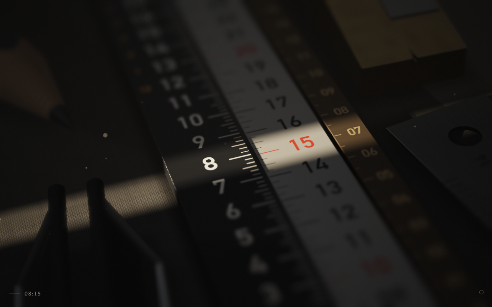

# Sunlit Scale New Tab

A Chrome extension that replaces the new tab page with three scales on a desk, seen through a macro lens, and a narrow line of light across them. The time is wherever the light falls.

An engraved 24-hour stock, an aluminium minute tape and an antiqued-brass seconds strip lie side by side on dark linen, the blind is down, and the desk is in soft shade. Through a gap in the blind to the left, one thin sheet of sunlight crosses the desk, and the three scales slide so that the hour, the minute and the second of now stand in it; everything else stays in the shade, still legible. The hour creeps and then pulls into place at the turn of the hour, the minute glides on at the turn of the minute, and the seconds step like an escapement: a quick, soft glide, then each figure rests in the light. The light follows the time of day: pale gold in the morning, white at noon, amber late in the afternoon, the line drifting a little down the desk as the sun goes round. When the sun goes behind the houses opposite, a small desk lamp to the right comes on and, through a slot cut in a card, lays a warm line in the same place; at dawn it goes off and the scales glide up to the sun's line. The lens is a 100 mm macro at f/14.6, focused once on the line of light: the scales fall soft in front of it and behind it, the linen softer, and the things on the desk melt with their height. Dust glints only as it drifts through the beam. A few things from a working desk (a pencil, an eraser, paper clips, a binder clip, a steel rule, a divider, a screwdriver, tweezers, a brass sharpener) are laid out afresh for each new tab, never shading the figures of now. In the lower left, small, is the time.



- Manifest V3, no permissions, no network requests
- WebGL 2 and vanilla JavaScript, no build step; ray-traced scales and things, a thin-lens depth of field, dust and glints drawn as the lens would draw them
- The light is the time of day only (no location): sun, sky, lamp and exposure come from a table of the day's light
- Each new tab lays the desk out afresh; the scales and the light are the same
- Respects `prefers-reduced-motion` (the dust stands still, and there is less of it); without WebGL 2 only the small time shows
- Drawn at the screen's full resolution (device pixel ratio up to 2) and about 30 fps; between steps only the column of the tape and the strip is drawn again

## Playground

Click the faint ring in the lower-right corner (its accessible name is "playground"), press G, or add `#gui` to the page URL to open a bar. Its upper row is the day: a slider over the time of day (0 to 24 h, coloured with the day's light), play and pause at x1 to x3600, and a button back to the real time, lit while the time shown is not now. Played at x60 or faster, the seconds strip rests at 00 and the lamp and the dawn glide take a moment on the screen. The lower row is the camera: angle, yaw, roll, distance, zoom, aim, f-stop and focus, with reset back to the tuned camera. The camera is kept in the browser (`localStorage`, key `sunlit.camera`) and every new tab opens with it; the time is not kept: closing the bar, or a new tab, goes back to the real time. The labels follow Chrome's language (Japanese or English).

## Debug

`#t=HH:MM` or `#t=HH:MM:SS` fixes the time, and `#seed=N` brings a desk back (the screenshots use seeds 1, 4, 3 and 9).

## Install from source

1. Open `chrome://extensions` and turn on Developer mode.
2. Click "Load unpacked" and choose the `extension/` folder.
3. Open a new tab.

To preview a fixed time of day, open the page with a hash such as `newtab.html#t=16:52&seed=3`.

## Package for the Chrome Web Store

```sh
mkdir -p ../dist/sunlit && cd extension && zip -rqX ../../dist/sunlit/sunlit-scale-newtab.zip manifest.json newtab.html newtab.js icons _locales
```

Store graphics are in [`store/`](store/); `node sunlit/store/media.mjs shots|videos` makes them again.

---

新しいタブを、机の上の三本の目盛りと、それを横切るひと筋の光で時刻を示す時計に置き換える Chrome 拡張機能です。権限・外部通信なし。
